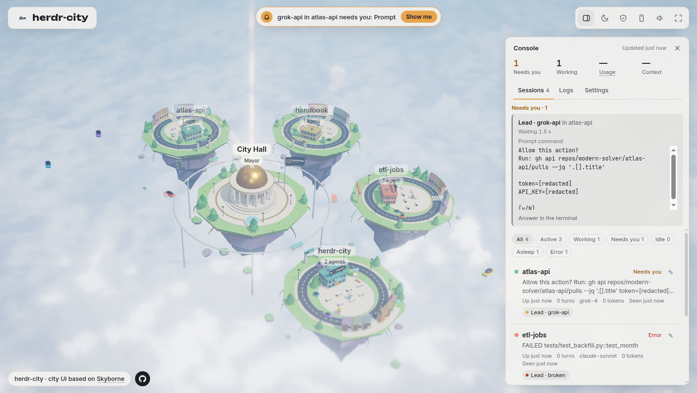

# mastopia

Local web GUI that shows every [herdr](https://herdr.dev) agent as a live 3D sky city. Model-agnostic: Claude, Grok, Gemini, Codex, or any CLI herdr can detect.

The city and console frontend are derived from [Skyborne](https://github.com/ishraq21/skyborne) (Apache-2.0). Skyborne ingests Claude Code hooks; mastopia replaces that with a **read-only herdr adapter**. New name and logo (Skyborne's TRADEMARK.md forbids reusing its marks). See `NOTICE` and `LICENSE`.

**P0 is read-only.** The process never runs `herdr pane send-keys`, never `herdr server stop`, and never writes to herdr. No telemetry, no cloud calls. The HTTP server binds **127.0.0.1 only**.

<p align="center"></p>

## What you see

| herdr | City |
| --- | --- |
| workspace (`w1`, `w8`, `wD`, …) | district |
| agent in a pane | robot (name = herdr agent `name`, badge = model / `agent` kind) |
| `working` | cyan eyes |
| `blocked` / waiting | amber + **Needs you** card with the prompt text from the pane |
| idle 10 minutes or more | dim / asleep |
| error text on the pane | red |

Approvals from the GUI are **not** in P0. Answer the prompt in the herdr pane. P2 (later) may send a single yes.

## Requirements

- Node.js 20 or newer
- For live mode: [herdr](https://herdr.dev) 0.9.x on `PATH`, with a running session
- Windows 10+, macOS, or Linux. PowerShell is fine on Windows.

## Fixture demo (no herdr)

CI and first-run demos use checked-in fixtures:

```powershell
git clone https://github.com/modern-solver/mastopia.git
cd mastopia
npm run fixture
```

Open http://127.0.0.1:7740/ — several districts appear within a couple of seconds, including **atlas-api** with a blocked Grok robot and a Needs you card for `Allow this action?`.

Unix:

```bash
npm run fixture
```

## Live herdr on Windows (PowerShell)

1. Install herdr 0.9.x and start a session as you usually do (do **not** stop the server from this app).
2. Confirm the CLI talks JSON:

   ```powershell
   herdr agent list
   herdr pane read w1:p1 --source recent-unwrapped --lines 80
   ```

3. From this repo:

   ```powershell
   cd path\to\mastopia
   npm run build:page
   node .\src\cli.js
   ```

   Or `npm start` (builds the page, then serves live herdr). Optional: `$env:HERDR_BIN = "C:\path\to\herdr.exe"` if `herdr` is not on `PATH`.

4. Open http://127.0.0.1:7740/ in a browser on the same PC.

Polling: `herdr agent list` every 2 seconds. `herdr pane read <pane>` runs **only when that agent's fingerprint changes** (`agent_status`, `revision`, `state_change_seq`, terminal title, cwd) — not every tick.

## JSON API

Same origin, 127.0.0.1:

| Path | |
| --- | --- |
| `GET /api/city` | districts, robots, asks (Needs you) |
| `GET /api/agents` | flat robot list |
| `GET /api/sessions` | console session list (district, cli, model, status, `q` filters) |
| `GET /api/screen` | last pane read after `maskSecrets` (`paneId` required) |
| `GET /api/ops-desk` | blocked sessions with a prompt (`recommendation` always null) |
| `GET /events` | Skyborne-compatible SSE for the city page |
| `GET /health` | liveness |
| `POST /api/answer` | always `409` readonly |
| `POST /api/send-keys` | always `409` readonly |
| `POST /api/send-text` | always `409` readonly |
| `POST /api/prompt` | always `409` readonly |

## Prompt detection

Per-CLI patterns live in `config/prompt-patterns.json` (Claude, Grok, Gemini, plus a generic fallback). Add another CLI by appending a `clis[]` entry with `matchKinds` / `matchTitles` and `contains` or `regex` patterns. Pane text is masked for token-looking strings before it is shown (`src/mask.js`).

## Tests

```powershell
npm ci
npm test
npm run lint
npm run format:check
```

`npm ci` installs locked devDependencies. `npm run lint` runs ESLint. `npm run format:check` runs Prettier check. GitHub Actions (ubuntu) runs the same four commands. herdr is not installed in CI.
`npm run codemap` regenerates `docs/CODEMAP.md`; run it after adding or removing files or exports; `npm test` fails when the map is stale.

## herdr JSON fields (verified)

Adapter parsing is written against herdr's published CLI/socket docs and source (`AgentInfo` in `src/api/schema/agents.rs`, `AgentStatus` in `common.rs`, `herdr agent list` → `result.type: "agent_list"` with `agents[]`):

| Field | Role |
| --- | --- |
| `name` | robot name |
| `agent` | kind (claude, grok, gemini, …) |
| `pane_id` | pane read target (`w1:p1`) |
| `workspace_id` | district id |
| `cwd` / `foreground_cwd` | district title fallback |
| `agent_status` | `idle` \| `working` \| `blocked` \| `done` \| `unknown` |
| `terminal_title` / `terminal_title_stripped` | activity line |
| `display_agent`, `tokens.model` | model badge |
| `revision`, `state_change_seq` | change detection |
| `title` | optional metadata title |

`herdr pane read` prints UTF-8 text (not JSON) by default; if JSON with `result.read.text` appears, that is used. Workspace labels come from optional `herdr workspace list` (`WorkspaceInfo.label`).

**Open questions:** herdr does not expose “idle for N minutes” on `AgentInfo`, so asleep/dim is measured from when mastopia last saw `working`/`blocked` (fixture agents may set `_idle_for_ms` for demos). `unknown` is treated as idle unless the pane looks like an error. Token usage is not in P0.

## License

Apache License 2.0. City UI based on Skyborne; see `NOTICE`.
